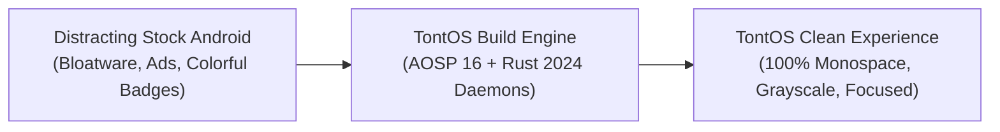
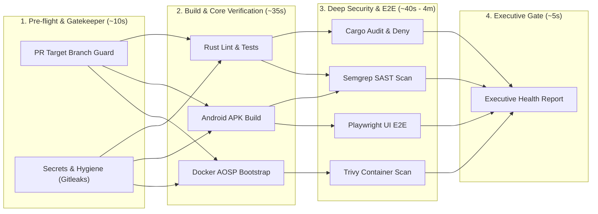

# TontOS

<div align="center">

```text
████████╗ ██████╗ ███╗   ██╗████████╗ ██████╗ ███████╗
╚══██╔══╝██╔═══██╗████╗  ██║╚══██╔══╝██╔═══██╗██╔════╝
   ██║   ██║   ██║██╔██╗ ██║   ██║   ██║   ██║███████╗
   ██║   ██║   ██║██║╚██╗██║   ██║   ██║   ██║╚════██║
   ██║   ╚██████╔╝██║ ╚████║   ██║   ╚██████╔╝███████║
   ╚═╝    ╚═════╝ ╚═╝  ╚═══╝   ╚═╝    ╚═════╝ ╚══════╝
```

**Intentional Mobile Computing · Bloat-Free AOSP · Low-Dopamine Monospace Architecture**

[](https://github.com/FalseThinks/TontOS/actions/workflows/main.yml)
[](https://github.com/FalseThinks/TontOS/releases)
[-DEA584.svg?style=flat-square&logo=rust&logoColor=white)](https://www.rust-lang.org/)
[%20|%20API%2034-3DDC84.svg?style=flat-square&logo=android&logoColor=white)](https://source.android.com/)
[-10B981.svg?style=flat-square)](crates/)
[-059669.svg?style=flat-square)](crates/)
[](Dockerfile.aosp)
[](LICENSE)

*Created and maintained by [FalseThinks](https://github.com/FalseThinks) (`paproken@protonmail.com`)*

</div>

---

## Table of Contents

1. [Overview & Philosophy](#overview--philosophy)
2. [Key Features & Pillars](#key-features--pillars)
3. [Prerequisites & System Requirements](#prerequisites--system-requirements)
4. [Installation & Getting Started](#installation--getting-started)
   - [Path A: Standalone Launcher APK (Fastest)](#path-a-standalone-launcher-apk-fastest)
   - [Path B: Docker-based Parallel ROM Build (Recommended)](#path-b-docker-based-parallel-rom-build-recommended)
   - [Path C: Native AOSP ROM Compilation](#path-c-native-aosp-rom-compilation)
5. [Running & Flashing](#running--flashing)
6. [Repository Architecture](#repository-architecture)
7. [Security & Quality Assurance](#security--quality-assurance)
8. [Continuous Integration (CI/CD Pipeline)](#continuous-integration-cicd-pipeline)
9. [Branch Strategy & Contribution Guidelines](#branch-strategy--contribution-guidelines)
10. [License & Mandatory Attribution](#license--mandatory-attribution)

---

## Overview & Philosophy

**TontOS** is an open-source, minimalist mobile operating system engineered from the ground up for **digital autonomy, deep focus, and battery preservation**. 

Unlike superficial launcher skins or post-install debloater scripts, TontOS integrates directly into the **Android Open Source Project (AOSP)** build system, producing a pure, unencumbered ROM target devoid of background analytics, vendor services, duplicate applications, and dopamine-inducing visual triggers.



---

## Key Features & Pillars

### 1. 🧘 Digital Detox by Design
* **100% Monospace Visual Uniformity:** Eliminates variable-width typographic cues and marketing typography across all system dialogs, settings, and drawer views.
* **4 Low-Stimulus Color Presets:** High-contrast AMOLED Black (`#000000`), Amber CRT phosphor, Slate Midnight, and inverted E-Ink Paper.
* **KMS / SurfaceFlinger Grayscale:** Direct system daltonizer integration removing color dopamine at the compositor layer.
* **Mindful Launch Friction:** Configurable 3s to 10s pause before opening distracting non-essential apps.
* **Notification Batching & Digests:** Eliminates instant ping interruptions by bundling non-starred alerts into scheduled delivery windows (12:00 and 18:00).

### 2. 🛡️ Native Vanilla AOSP 16 Target
* **Hermetic Custom Target (`tontos_cf_x86_64`):** Defined cleanly under `platform/vendor/tontos/` with its own `AndroidProducts.mk` and `BoardConfig.mk`.
* **Zero-Bloat Build:** Excludes default Google Mobile Services (GMS), Telemetry, search bars, and redundant media engines at compile-time.
* **FOSS Core Ecosystem:** Pre-integrates vetted open-source utilities (`org.fossify.*`, `eu.faircode.email`, `com.aurora.store`).

### 3. 🦀 Hardened Rust System Suite (14 Crates)
* **Rust 1.99.0 & 2024 Edition:** Built using modern let-chain idioms, zero-allocation iterators, and strict safety contracts.
* **`forbid(unsafe_code)`:** 100% verified safe Rust across all daemons and library crates.
* **Streaming Cryptography:** Artifact verification and snapshot generation use streaming SHA-256 with constant memory footprint.
* **Atomic Cgroups Management:** Background task throttling and application freezing via cgroups v2 (`tont-appd`).

### 4. 🔒 System Hardening & Security
* **Command Sanitization:** All privileged system operations (`cmd statusbar`, `cmd appops`, `iptables`) execute strictly via [`SafeCommandExecutor.java`](launcher_apk/src/org/tontos/launcher/SafeCommandExecutor.java) with regex validation (`^[a-zA-Z0-9._-]+$`), eliminating shell injection risks.
* **Per-App Network Firewall:** Toggle background network access and internet socket permissions per UID via [`AppNetworkFirewall.java`](launcher_apk/src/org/tontos/launcher/AppNetworkFirewall.java).
* **Battery Health Throttling:** 80% charge threshold limiting via sysfs nodes to extend battery lifespan.

---

## Prerequisites & System Requirements

Depending on what component you wish to build or run, ensure your machine satisfies the following:

### Hardware Requirements
| Component | Minimum | Recommended | Notes |
|:---|:---|:---|:---|
| **CPU** | 4 Cores | 8 - 16 Cores | AOSP compilation scales linearly with CPU threads |
| **RAM** | 16 GB | 16 GB - 32 GB | Plus 16-32 GB swap for C++ linking phases |
| **Disk Space** | 500 MB (Launcher only) | 120 GB - 150 GB (Full ROM) | High-speed NVMe SSD recommended for AOSP |

### Software Dependencies
* **Host Operating System:** Linux (Ubuntu 22.04/24.04 LTS, Debian 12+, Fedora, Arch Linux).
* **Docker Engine:** Version 24.0+ (Required for isolated, containerized builds).
* **Java Development Kit:** OpenJDK 17 Headless (`sudo apt install openjdk-17-jdk-headless`).
* **Rust Toolchain:** Rust 1.99.0+ (Configured automatically via [`rust-toolchain.toml`](rust-toolchain.toml)).
* **Android Tools:** `adb`, `fastboot`, and Android SDK Platform 34 / Build-Tools 36.0.0.
* **Package Manager:** `pnpm` (for Playwright Web UI tests; never use `npm`).

---

## Installation & Getting Started

### Path A: Standalone Launcher APK (Fastest)

If you only want the ultra-lightweight, dopamine-free launcher on an existing Android device:

1. **Compile and Sign the APK:**
   ```bash
   ./scripts/build_launcher_apk.sh
   ```
   *The signed APK is output to `launcher_apk/tontos-launcher.apk` (< 2 MB budget).*

2. **Install via ADB:**
   ```bash
   adb install -r launcher_apk/tontos-launcher.apk
   ```

3. **Set as Default Launcher:**
   ```bash
   adb shell cmd package set-home-activity org.tontos.launcher/.MainActivity
   ```

4. **Grant Secure Settings for Daltonizer / Grayscale (Optional):**
   ```bash
   adb shell pm grant org.tontos.launcher android.permission.WRITE_SECURE_SETTINGS
   ```

---

### Path B: Docker-based Parallel ROM Build (Recommended)

To compile the entire TontOS system image without polluting your host development environment:

1. **Sync AOSP Sources (Checked out to `~/aosp/tontos`):**
   ```bash
   ./scripts/aosp_preflight.sh
   ./scripts/sync_aosp.sh
   ```

2. **Run the Multi-Threaded Build Container:**
   ```bash
   ./scripts/docker_build_rom.sh
   ```
   *Features automatically enabled:*
   - **Hardware Detection:** Dynamically sets compiler worker threads (`-j$(nproc)`) based on CPU and RAM.
   - **50 GB CCache:** Pre-configured compiler cache storing C/C++ compilation units to make rebuilds take minutes instead of hours.
   - **Target-Optimized:** Compiles `bootimage systemimage vbmetaimage` (~25-40 GB) rather than 120 GB of redundant tests.

3. **Custom Thread Override (Optional):**
   ```bash
   # Example: Force 12 parallel threads and custom image target
   BUILD_JOBS=12 BUILD_TARGET="bootimage systemimage" ./scripts/docker_build_rom.sh
   ```

---

### Path C: Native AOSP ROM Compilation

For native builds directly on your host environment:

1. **Source Build Environment:**
   ```bash
   cd ~/aosp/tontos
   source build/envsetup.sh
   ```

2. **Select TontOS Target:**
   ```bash
   lunch tontos_cf_x86_64-bp4a-userdebug
   ```

3. **Trigger Parallel Compilation:**
   ```bash
   # Enable ccache for instant incremental builds
   export USE_CCACHE=1
   export CCACHE_DIR="$HOME/.ccache"
   ccache -M 50G

   # Parallel build using available CPU cores
   m -j$(nproc) bootimage systemimage vbmetaimage
   ```

---

## Running & Flashing

### 1. Launch in Cuttlefish Emulator (x86_64)
Once the compilation finishes, launch the virtual device with host acceleration:
```bash
./scripts/run_emulator_tontos.sh
```

### 2. Flashing Generic System Image (GSI)
To flash TontOS onto Project Treble-compliant physical devices:
```bash
# Reboot into fastbootd mode
adb reboot fastboot

# Flash partition images
fastboot flash vbmeta out/target/product/tontos_cf_x86_64/vbmeta.img --disable-verity --disable-verification
fastboot flash boot out/target/product/tontos_cf_x86_64/boot.img
fastboot flash system out/target/product/tontos_cf_x86_64/system.img
fastboot reboot
```

---

## Repository Architecture

```text
.
├── crates/                    # 14 Rust Workspace System Crates
│   ├── tont-common/           # Core traits, error types, and logging primitives
│   ├── tont-romctl/           # Hardware sysfs control, battery 80% limits, profiles
│   ├── tont-powerd/           # Thermal states, screen timeouts, wakelock daemon
│   ├── tont-appd/             # Process supervisor & cgroups v2 atomic freezer
│   ├── tont-syncd/            # Radio synchronization batching
│   ├── tont-settings/         # Low-power theme tokens and hardware settings engine
│   ├── tont-storage/          # Atomic disk serialization & cryptographic snapshots
│   └── ...                    # Input, compositor, telephony, backup daemons
├── launcher_apk/              # First-Party System Launcher (Java 17, AOSP System Ext)
│   ├── src/org/tontos/launcher/
│   │   ├── MainActivity.java        # Zero-allocation monospace home & drawer
│   │   ├── SettingsActivity.java    # Hardware & OS preferences
│   │   ├── SettingsRowFactory.java  # Modular decoupled UI builder
│   │   ├── SafeCommandExecutor.java # Sanitized process executor
│   │   ├── GrayscaleManager.java    # Daltonizer display monochrome controller
│   │   └── AppNetworkFirewall.java  # Per-app UID firewall interface
│   └── AndroidManifest.xml
├── platform/                  # AOSP Vendor Tree & Manifest Definitions
│   ├── vendor/tontos/         # Product definitions (tontos_cf_x86_64.mk)
│   └── manifests/             # Pinned AOSP BP4A revision manifests
├── scripts/                   # Tooling, Container & Preflight Scripts
│   ├── docker_build_rom.sh    # Multi-threaded AOSP compilation in Docker
│   ├── build_launcher_apk.sh  # Standalone launcher APK compilation & signing
│   ├── sync_aosp.sh           # Minimal AOSP tree synchronization
│   └── generate_ci_report.sh  # Executive vulnerability and coverage reporter
├── Dockerfile.aosp            # Ultra-lightweight Debian Slim glibc builder
└── tests/                     # Playwright visual DOM & E2E integration tests
```

---

## Security & Quality Assurance

All Rust crates, Java services, and system scripts adhere to strict automated quality constraints:

```bash
# 1. Verify Rust formatting, lints and unit tests (53/53 tests pass)
cargo fmt --all -- --check
cargo clippy --workspace --all-targets -- -D warnings
cargo test --workspace

# 2. Audit Rust dependencies for vulnerabilities
cargo audit
cargo deny check

# 3. Test launcher build and verify size budget (< 2 MB)
./scripts/build_launcher_apk.sh

# 4. Run end-to-end visual tests with Playwright
cd tests/ui && pnpm test
```

---

## Continuous Integration (CI/CD Pipeline)

Our GitHub Actions pipeline is organized into a **4-stage Directed Acyclic Graph (DAG)** ensuring fast feedback and thorough auditing:



* **Fail-Fast Safety:** If a credential leak or shell syntax error is detected in Stage 1, the pipeline halts immediately, saving compute resources.
* **Zero Shell Injection:** All CI workflow steps isolate GitHub context variables inside environment variables (`env:`) to eliminate injection vectors.

---

## Branch Strategy & Contribution Guidelines

We enforce a professional, structured Git workflow to protect release stability:

* **`development` (Integration Branch):** The primary active branch. **All community Pull Requests and feature branches must target `development`**.
* **`main` (Release & Production):** The stable release branch. Pushes to `main` automatically trigger [`release.yml`](.github/workflows/release.yml) to create versioned Git tags, compile release APKs, and publish GitHub Releases.

```text
feature-branch ──────> development (Pull Request + CI) ──────> main (Release Pipeline)
```

---

## License & Mandatory Attribution

TontOS is dual-licensed under:
* **Apache License, Version 2.0** ([LICENSE](LICENSE))
* **MIT License** ([LICENSE-MIT](LICENSE-MIT))

### Mandatory Attribution Notice
Per **Section 4 of the Apache License 2.0** and the **MIT License** conditions:
* You are free to fork, modify, and redistribute this software for personal or commercial use.
* Any fork, derivative work, or redistributed ROM **must retain all original copyright notices** and attribute the author:

> **"Based on TontOS by FalseThinks <paproken@protonmail.com>"**

See [`NOTICE`](NOTICE) for the legally binding attribution terms.  
Copyright © 2026 **FalseThinks** (`paproken@protonmail.com`). All rights reserved.
