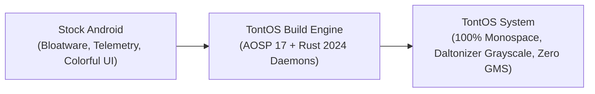
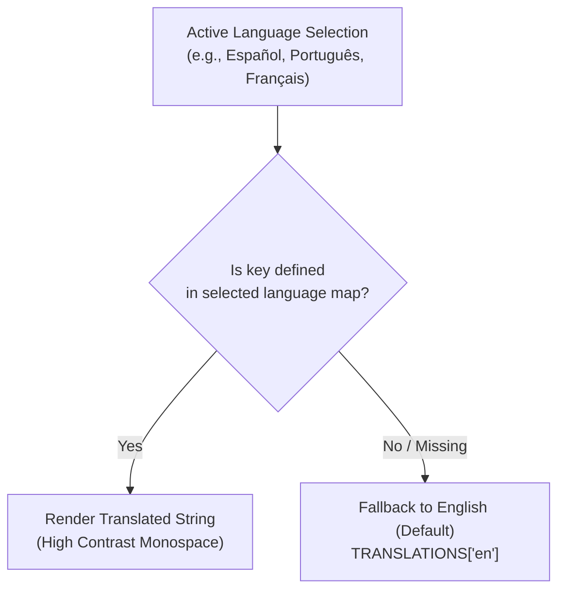
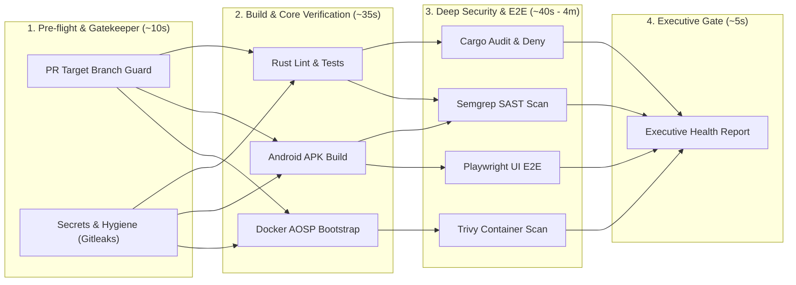

# TontOS

<div align="center">

```text
████████╗ ██████╗ ███╗   ██╗████████╗ ██████╗ ███████╗
╚══██╔══╝██╔═══██╗████╗  ██║╚══██╔══╝██╔═══██╗██╔════╝
   ██║   ██║   ██║██╔██╗ ██║   ██║   ██║   ██║███████╗
   ██║   ██║   ██║██║╚██╗██║   ██║   ██║   ██║╚════██║
   ██║   ╚██████╔╝██║ ╚████║   ██║   ╚██████╔╝███████║
   ╚═╝    ╚═════╝ ╚═╝  ╚═══╝   ╚═╝    ╚═════╝ ╚══════╝
```

**Intentional Mobile Computing · Bloat-Free AOSP · Low-Dopamine Monospace Architecture**

[](https://github.com/FalseThinks/TontOS/actions/workflows/main.yml)
[](https://github.com/FalseThinks/TontOS/releases)
[-DEA584.svg?style=flat-square&logo=rust&logoColor=white)](https://www.rust-lang.org/)
[-3DDC84.svg?style=flat-square&logo=android&logoColor=white)](https://source.android.com/)
[-10B981.svg?style=flat-square)](crates/)
[-059669.svg?style=flat-square)](crates/)
[](Dockerfile.aosp)
[](LICENSE)

*Created and maintained by [FalseThinks](https://github.com/FalseThinks) (`paproken@protonmail.com`)*

</div>

---

## Table of Contents

1. [Overview & Philosophy](#overview--philosophy)
2. [Key Features & Pillars](#key-features--pillars)
3. [Prerequisites & System Requirements](#prerequisites--system-requirements)
4. [Installation & Getting Started](#installation--getting-started)
   - [Path A: Standalone Launcher APK (Fastest)](#path-a-standalone-launcher-apk-fastest)
   - [Path B: Docker-based Parallel ROM Build (Recommended)](#path-b-docker-based-parallel-rom-build-recommended)
   - [Path C: Native AOSP ROM Compilation](#path-c-native-aosp-rom-compilation)
5. [Running & Flashing](#running--flashing)
6. [Scripts & Automation Catalog](#scripts--automation-catalog)
7. [Internationalization & Language Roadmap](#internationalization--language-roadmap)
8. [Repository Architecture](#repository-architecture)
9. [Security & Quality Assurance](#security--quality-assurance)
10. [Continuous Integration (CI/CD Pipeline)](#continuous-integration-cicd-pipeline)
11. [Branch Strategy & Contribution Guidelines](#branch-strategy--contribution-guidelines)
12. [License & Mandatory Attribution](#license--mandatory-attribution)

---

## Overview & Philosophy

**TontOS** is an open-source mobile operating system engineered for minimal battery consumption, zero telemetry, and low visual distraction.

TontOS compiles directly into the **Android Open Source Project (AOSP)** build tree. It strips Google Mobile Services (GMS), telemetry packages, and stock system apps at compile-time, producing a lightweight, single-layer system image with first-party monospace UI and Rust system daemons.



---

## Key Features & Pillars

### 1. Digital Detox & Minimalist UI
* **100% Monospace Visual Uniformity:** Monospace typography across all launcher screens, dialogs, drawer rows, and settings sections.
* **4 Low-Power Color Presets:** High-contrast AMOLED Black (`#000000`), Amber CRT phosphor, Slate Midnight, and inverted E-Ink Paper.
* **Custom Minimal Lockscreen:** 6 monospace clock layouts (*Terminal Retro*, *Minimal Sans*, *Vertical Stacked*, *Analog Monospace*, *Binary Matrix*, *Compact Status*) with independent theme styling.
* **5-Band Equalizer & Audio Profiles:** Native audiofx equalizer with master on/off switch, 5 preset profiles (Flat, Bass Boost, Vocal, Treble, Rock), and manual sliders from 60Hz to 14kHz.
* **Contextual Help Badges `(?)`:** Monospace dialog definitions attached to each system setting and toggle.
* **KMS / SurfaceFlinger Grayscale:** Direct accessibility daltonizer integration to render the entire OS in monochrome.
* **Launch Delay (Friction):** Configurable 3s to 10s pause before launching non-whitelisted apps.
* **Scheduled Notification Digests:** Batches non-starred notifications into scheduled delivery windows (12:00 and 18:00).

### 2. Native AOSP 17 Target & Universal GSI
* **Hermetic Target (`tontos_cf_x86_64`):** Maintained under `platform/products/` with dedicated `AndroidProducts.mk` and `BoardConfig.mk`.
* **Universal GSI Support:** Multi-architecture Treble system images for `arm64`, `arm` (32-bit Go), and `x86_64`.
* **Compile-Time Debloating:** Excludes Google Mobile Services (GMS), background trackers, search widgets, and stock media engines during AOSP build.
* **FOSS Core Ecosystem:** Pre-installs vetted open-source utilities (`org.fossify.*`, `eu.faircode.email`, `com.aurora.store`) with pre-granted storage, camera, and contact permissions (`default-permissions-tontos.xml`).

### 3. Rust System Daemons (14 Crates)
* **Rust 1.99.0 & 2024 Edition:** Built using modern let-chain idioms, zero-allocation iterators, and strict safety contracts.
* **`forbid(unsafe_code)`:** 100% verified safe Rust across all daemons and library crates.
* **Streaming Cryptography:** Constant-memory streaming SHA-256 for system backups and artifact verification.
* **Atomic Cgroups Management:** Process freezing and memory throttling via cgroups v2 (`tont-appd`).

### 4. System Hardening & Security
* **Sanitized Execution:** Privileged system commands execute strictly through [`SafeCommandExecutor.java`](launcher_apk/src/org/tontos/launcher/SafeCommandExecutor.java) with strict regex validation (`^[a-zA-Z0-9._-]+$`), eliminating shell injection risks.
* **Per-App Network Firewall:** Toggle background socket access and network permissions per UID via [`AppNetworkFirewall.java`](launcher_apk/src/org/tontos/launcher/AppNetworkFirewall.java).
* **Battery Charge Limit:** 80% charge threshold limiting via sysfs nodes to extend battery lifespan.

---

## Prerequisites & System Requirements

Depending on what component you wish to build or run, ensure your machine satisfies the following:

### Hardware Requirements
| Component | Minimum | Recommended | Notes |
|:---|:---|:---|:---|
| **CPU** | 4 Cores | 8 - 16 Cores | AOSP compilation scales linearly with CPU threads |
| **RAM** | 16 GB | 16 GB - 32 GB | Plus 16-32 GB swap for C++ linking phases |
| **Disk Space** | 500 MB (Launcher only) | 120 GB - 150 GB (Full ROM) | High-speed NVMe SSD recommended for AOSP |

### Software Dependencies
* **Host Operating System:** Linux (Ubuntu 22.04/24.04 LTS, Debian 12+, Fedora, Arch Linux).
* **Docker Engine:** Version 24.0+ (Required for isolated, containerized builds).
* **Java Development Kit:** OpenJDK 17 Headless (`sudo apt install openjdk-17-jdk-headless`).
* **Rust Toolchain:** Rust 1.99.0+ (Configured automatically via [`rust-toolchain.toml`](rust-toolchain.toml)).
* **Android Tools:** `adb`, `fastboot`, and Android SDK Platform 34 / Build-Tools 36.0.0.
* **Package Manager:** `pnpm` (for Playwright Web UI tests; never use `npm`).

---

## Installation & Getting Started

### Path A: Standalone Launcher APK (Fastest)

If you only want the ultra-lightweight, dopamine-free launcher on an existing Android device:

1. **Compile and Sign the APK:**
   ```bash
   ./scripts/build_launcher_apk.sh
   ```
   *The signed APK is output to `launcher_apk/tontos-launcher.apk` (< 2 MB budget).*

2. **Install via ADB:**
   ```bash
   adb install -r launcher_apk/tontos-launcher.apk
   ```

3. **Set as Default Launcher:**
   ```bash
   adb shell cmd package set-home-activity org.tontos.launcher/.MainActivity
   ```

4. **Grant Secure Settings for Daltonizer / Grayscale (Optional):**
   ```bash
   adb shell pm grant org.tontos.launcher android.permission.WRITE_SECURE_SETTINGS
   ```

---

### Path B: Docker-based Parallel ROM Build (Recommended)

To compile the entire TontOS system image without polluting your host development environment:

1. **Sync AOSP Sources (Checked out to `~/aosp/tontos`):**
   ```bash
   ./scripts/aosp_preflight.sh
   ./scripts/sync_aosp.sh
   ```

2. **Run the Multi-Threaded Build Container:**
   ```bash
   ./scripts/docker_build_rom.sh
   ```
   *Features automatically enabled:*
   - **Hardware Detection:** Dynamically sets compiler worker threads (`-j$(nproc)`) based on CPU and RAM.
   - **50 GB CCache:** Pre-configured compiler cache storing C/C++ compilation units to make rebuilds take minutes instead of hours.
   - **Target-Optimized:** Compiles `bootimage systemimage vbmetaimage` (~25-40 GB) rather than 120 GB of redundant tests.

3. **Custom Thread Override (Optional):**
   ```bash
   # Example: Force 12 parallel threads and custom image target
   BUILD_JOBS=12 BUILD_TARGET="bootimage systemimage" ./scripts/docker_build_rom.sh
   ```

---

### Low-Memory Systems Optimization & OOM Mitigation (16 GB RAM)

AOSP 17 (Baklava) uses `soong_build` written in Go to analyze module definitions across Blueprint files. On workstations with 16 GB RAM or less, unconstrained builds risk triggering kernel OOM kills (`signal:killed`, exit code 137). TontOS incorporates explicit optimizations to build cleanly within 16 GB RAM constraints:

#### 1. Go Runtime Memory Caps (`GOMEMLIMIT` & `GOGC`)
`soong_build` is invoked via Blueprint's bootstrap ninja rules. To stop the Go garbage collector from delaying collection while traversing 100,000+ AST nodes:
* `GOMEMLIMIT=7GiB`: Sets a soft memory ceiling, instructing Go to aggressively collect heap space before physical RAM saturates.
* `GOGC=15`: Reduces the heap trigger threshold to 15% (down from 100%), keeping AST memory footprint deterministic.
* `GOMAXPROCS=2`: Throttles concurrent AST processing routines to avoid parallel allocation bursts.

These flags are defined in `build/blueprint/bootstrap/bootstrap.go` under `generateBuildNinja` and baked into `out/soong/bootstrap.ninja`.

#### 2. Swapfile Setup (Btrfs & ext4)
AOSP Soong analysis requires burst virtual memory. If running on Btrfs (e.g. CachyOS, Fedora, openSUSE), create an unfragmented swapfile using dedicated Btrfs tools:
```bash
# Btrfs (recommended 32 GB for AOSP 17 full reanalysis)
sudo btrfs filesystem mkswapfile --size 32g --uuid clear /swapfile_aosp
sudo swapon /swapfile_aosp

# Standard ext4 / XFS
sudo fallocate -l 32G /swapfile_aosp
sudo chmod 600 /swapfile_aosp
sudo mkswap /swapfile_aosp
sudo swapon /swapfile_aosp
```

#### 3. `systemd-oomd` Configuration
Distributions with active `systemd-oomd` kill cgroups when swap exceeds default limits (typically 90%). To prevent premature container termination:
* **Option A: Raise Swap Threshold in oomd.conf**
  ```bash
  sudo mkdir -p /etc/systemd/oomd.conf.d
  echo -e "[OOM]\nSwapUsedLimit=98%" | sudo tee /etc/systemd/oomd.conf.d/10-aosp-swap.conf
  sudo systemctl restart systemd-oomd
  ```
* **Option B: Exclude Docker Service from OOM Killer**
  ```bash
  sudo mkdir -p /etc/systemd/system/docker.service.d
  echo -e "[Service]\nManagedOOMPreference=omit" | sudo tee /etc/systemd/system/docker.service.d/override.conf
  sudo systemctl daemon-reload
  sudo systemctl restart docker
  ```

---

### Path C: Native AOSP ROM Compilation

For native builds directly on your host environment:

1. **Source Build Environment:**
   ```bash
   cd ~/aosp/tontos
   source build/envsetup.sh
   ```

2. **Select TontOS Target:**
   ```bash
   lunch tontos_cf_x86_64-trunk_staging-userdebug
   ```

3. **Trigger Parallel Compilation:**
   ```bash
   # Enable ccache for instant incremental builds
   export USE_CCACHE=1
   export CCACHE_DIR="$HOME/.ccache"
   ccache -M 50G

   # Parallel build using available CPU cores
   m -j$(nproc) bootimage systemimage vbmetaimage
   ```

---

## Running & Flashing

### 1. Running & Managing Cuttlefish Virtual Machine (x86_64)
Once the compilation finishes, launch or stop the virtual device:
```bash
# Launch Cuttlefish VM with host WebRTC acceleration (accessible at https://localhost:8443)
./scripts/run_cuttlefish.sh

# Stop running Cuttlefish VM & cleanly release sockets
./scripts/stop_cuttlefish.sh
```

### 2. Universal Generic System Image (GSI) Compilation & Flashing

TontOS includes universal Treble GSI support across all core mobile hardware architectures:
* **`arm64` (a64-ab):** 64-bit ARM for modern smartphones (>95% of devices: Snapdragon, Tensor, Dimensity, Exynos).
* **`arm` (a32-ab):** 32-bit ARM for entry-level devices (Android Go, budget chipsets, IoT).
* **`x86_64`:** 64-bit x86 for emulators, Chromebooks (ARC), and x86 handhelds.

#### Build Command
```bash
# Compile specific architecture
./scripts/build_gsi.sh --arch=arm64
./scripts/build_gsi.sh --arch=arm
./scripts/build_gsi.sh --arch=x86_64

# Compile all architectures in sequence
./scripts/build_gsi.sh --arch=all
```
*Artifacts are packaged under `out/gsi/<arch>/` with multi-threaded `xz` compression, SHA256 checksums, and auto-generated `flash_gsi.sh` scripts.*

#### Flashing via Fastbootd (Dynamic Partitions)
```bash
# 1. Boot into userspace fastbootd mode (required for Treble dynamic partitions)
adb reboot fastboot

# 2. Flash system partition
fastboot flash system out/gsi/arm64/tontos-gsi-arm64.img

# 3. Wipe user data & reboot
fastboot -w
fastboot reboot
```

---

## Scripts & Automation Catalog

TontOS provides a comprehensive suite of executable shell automation scripts in `scripts/`:

| Script | Purpose & Usage | Key Flags / Environment Variables |
|:---|:---|:---|
| [`build_launcher_apk.sh`](scripts/build_launcher_apk.sh) | Compiles Java 17 launcher with `javac`, generates Dex via `d8`, packages with `aapt2`, and signs with test key. | Outputs signed `launcher_apk/tontos-launcher.apk` (< 2MB). |
| [`build_gsi.sh`](scripts/build_gsi.sh) | Universal multi-arch GSI compiler (`arm64`, `arm`, `x86_64`, `all`) with auto-RAM throttling and packaging. | `--arch=arm64\|arm\|x86_64\|all`, `--docker`, `--jobs=N`, `--clean` |
| [`build_gsi_arm64.sh`](scripts/build_gsi_arm64.sh) | Convenience shortcut compiling ARM64 GSI system image (`system.img.xz`). | Delegates to `build_gsi.sh --arch=arm64` |
| [`build_gsi_arm.sh`](scripts/build_gsi_arm.sh) | Convenience shortcut compiling ARM32 GSI system image for Android Go devices. | Delegates to `build_gsi.sh --arch=arm` |
| [`docker_build_rom.sh`](scripts/docker_build_rom.sh) | Isolated containerized parallel AOSP 17 ROM compilation using Debian Slim glibc. | `BUILD_JOBS`, `BUILD_TARGET`, `CCACHE_DIR` |
| [`run_cuttlefish.sh`](scripts/run_cuttlefish.sh) | Launches Cuttlefish VM with host WebRTC daemon mode for live debugging at `https://localhost:8443`. | Sets up UDS `/tmp/cf_avd_1000`, port `6520` |
| [`stop_cuttlefish.sh`](scripts/stop_cuttlefish.sh) | Gracefully terminates Cuttlefish VM, releases WebRTC ports, and disconnects ADB. | Uses AOSP `stop_cvd` and cleans sockets |
| [`run_emulator_tontos.sh`](scripts/run_emulator_tontos.sh) | Quick launcher for virtual device environments with hardware/software GPU selection. | `--gpu_mode=guest_swiftshader` |
| [`debloat_custom_rom.sh`](scripts/debloat_custom_rom.sh) | Aggressive post-boot debloating script: disables telemetry, removes stock dialer, locks TontOS home role. | Run via `adb shell` or directly on device |
| [`sync_aosp.sh`](scripts/sync_aosp.sh) | Minimal repo manifest sync targeting `android-17.0.0_r1` without unnecessary vendor trees. | Uses pinned manifests in `platform/manifests/` |
| [`aosp_preflight.sh`](scripts/aosp_preflight.sh) | Verifies host system RAM, CPU cores, swap space, and disk limits before building AOSP. | Recommends >= 16GB RAM + 16GB swap |
| [`make_gsi_rootfs.sh`](scripts/make_gsi_rootfs.sh) | Packages Generic System Image root filesystem staging TontOSLauncher priv-app and FOSS APKs. | Configures file permissions (0644 / 0755) |
| [`make_initramfs.sh`](scripts/make_initramfs.sh) | Generates minimal Linux initramfs with early mount points and cgroups v2 hierarchy. | Embeds early boot scripts |
| [`make_ota_package.sh`](scripts/make_ota_package.sh) | Bundles cryptographic OTA payloads for distribution via update channels. | Produces update zip envelopes |
| [`generate_ci_report.sh`](scripts/generate_ci_report.sh) | Consolidates SAST, dependency audits, unit test results, and size checks into CI artifact. | Emits markdown summary |
| [`patch_play_integrity.sh`](scripts/patch_play_integrity.sh) | Applies minimal spoofing hooks to preserve basic app compatibility where required. | Hardened against detection |
| [`setup_sandboxed_google_pay.sh`](scripts/setup_sandboxed_google_pay.sh) | Guides sandboxed isolation for NFC contactless payments without background tracking. | Configures microG / sandboxed services |

---

## Internationalization & Language Roadmap

TontOS operates with an intentional multi-tier localization architecture:



### Primary Supported Tier
1. **Español (`es-ES`)** - Primary language tier (Full system coverage).
2. **Português (`pt-PT` / `pt-BR`)** - Primary language tier.
3. **Deutsch (`de-DE`)** - Primary language tier.
4. **Français (`fr-FR`)** - Primary language tier.
5. **Italiano (`it-IT`)** - Primary language tier.
6. **English (`en-US`)** - Global baseline & authoritative fallback.

### Safe English Fallback Guarantee
If any string, setting explanation, or system dialogue key is missing or incomplete in the selected target language, [`I18n.java`](launcher_apk/src/org/tontos/launcher/I18n.java) automatically and deterministically falls back to English (`en`) without crashing or showing blank rows.

### Expansion Roadmap
- [x] Full coverage of core setup wizard, drawer, and 5 settings sections in Primary Tier.
- [x] Explanatory help badges `(?)` with monospace dialogue definitions.
- [ ] Community translation onboarding via standard Web/PO or JSON contribution pipelines.
- [ ] Expanded tier: Polish (`pl`), Dutch (`nl`), Ukrainian (`uk`), Japanese (`ja`), Simplified Chinese (`zh`).
- [ ] Bi-directional text support (RTL) for Arabic and Hebrew minimalist layouts.

---

## Repository Architecture

```text
.
├── crates/                    # 14 Rust Workspace System Crates
│   ├── tont-common/           # Core traits, error types, and logging primitives
│   ├── tont-romctl/           # Hardware sysfs control, battery 80% limits, profiles
│   ├── tont-powerd/           # Thermal states, screen timeouts, wakelock daemon
│   ├── tont-appd/             # Process supervisor & cgroups v2 atomic freezer
│   ├── tont-syncd/            # Radio synchronization batching
│   ├── tont-settings/         # Low-power theme tokens and hardware settings engine
│   ├── tont-storage/          # Atomic disk serialization & cryptographic snapshots
│   └── ...                    # Input, compositor, telephony, backup daemons
├── launcher_apk/              # First-Party System Launcher (Java 17, AOSP System Ext)
│   ├── src/org/tontos/launcher/
│   │   ├── MainActivity.java        # Zero-allocation monospace home & drawer
│   │   ├── SettingsActivity.java    # Hardware & OS preferences
│   │   ├── SettingsRowFactory.java  # Modular decoupled UI builder
│   │   ├── SafeCommandExecutor.java # Sanitized process executor
│   │   ├── GrayscaleManager.java    # Daltonizer display monochrome controller
│   │   └── AppNetworkFirewall.java  # Per-app UID firewall interface
│   └── AndroidManifest.xml
├── platform/                  # AOSP Vendor Tree & Manifest Definitions
│   ├── vendor/tontos/         # Product definitions (tontos_cf_x86_64.mk)
│   └── manifests/             # Pinned AOSP 17 (android-17.0.0_r1) manifests
├── scripts/                   # Tooling, Container & Preflight Scripts
│   ├── docker_build_rom.sh    # Multi-threaded AOSP compilation in Docker
│   ├── build_launcher_apk.sh  # Standalone launcher APK compilation & signing
│   ├── sync_aosp.sh           # Minimal AOSP tree synchronization
│   └── generate_ci_report.sh  # Executive vulnerability and coverage reporter
├── Dockerfile.aosp            # Ultra-lightweight Debian Slim glibc builder
└── tests/                     # Playwright visual DOM & E2E integration tests
```

---

## Security & Quality Assurance

All Rust crates, Java services, and system scripts adhere to strict automated quality constraints:

```bash
# 1. Verify Rust formatting, lints and unit tests (53/53 tests pass)
cargo fmt --all -- --check
cargo clippy --workspace --all-targets -- -D warnings
cargo test --workspace

# 2. Audit Rust dependencies for vulnerabilities
cargo audit
cargo deny check

# 3. Test launcher build and verify size budget (< 2 MB)
./scripts/build_launcher_apk.sh

# 4. Run end-to-end visual tests with Playwright
cd tests/ui && pnpm test
```

---

## Continuous Integration (CI/CD Pipeline)

Our GitHub Actions pipeline is organized into a **4-stage Directed Acyclic Graph (DAG)** ensuring fast feedback and thorough auditing:



* **Fail-Fast Safety:** If a credential leak or shell syntax error is detected in Stage 1, the pipeline halts immediately, saving compute resources.
* **Zero Shell Injection:** All CI workflow steps isolate GitHub context variables inside environment variables (`env:`) to eliminate injection vectors.

---

## Branch Strategy & Contribution Guidelines

We enforce a professional, structured Git workflow to protect release stability:

* **`development` (Integration Branch):** The primary active branch. **All community Pull Requests and feature branches must target `development`**.
* **`main` (Release & Production):** The stable release branch. Pushes to `main` automatically trigger [`release.yml`](.github/workflows/release.yml) to create versioned Git tags, compile release APKs, and publish GitHub Releases.

```text
feature-branch ──────> development (Pull Request + CI) ──────> main (Release Pipeline)
```

---

## License & Mandatory Attribution

TontOS is dual-licensed under:
* **Apache License, Version 2.0** ([LICENSE](LICENSE))
* **MIT License** ([LICENSE-MIT](LICENSE-MIT))

### Mandatory Attribution Notice
Per **Section 4 of the Apache License 2.0** and the **MIT License** conditions:
* You are free to fork, modify, and redistribute this software for personal or commercial use.
* Any fork, derivative work, or redistributed ROM **must retain all original copyright notices** and attribute the author:

> **"Based on TontOS by FalseThinks <paproken@protonmail.com>"**

See [`NOTICE`](NOTICE) for the legally binding attribution terms.  
Copyright © 2026 **FalseThinks** (`paproken@protonmail.com`). All rights reserved.
